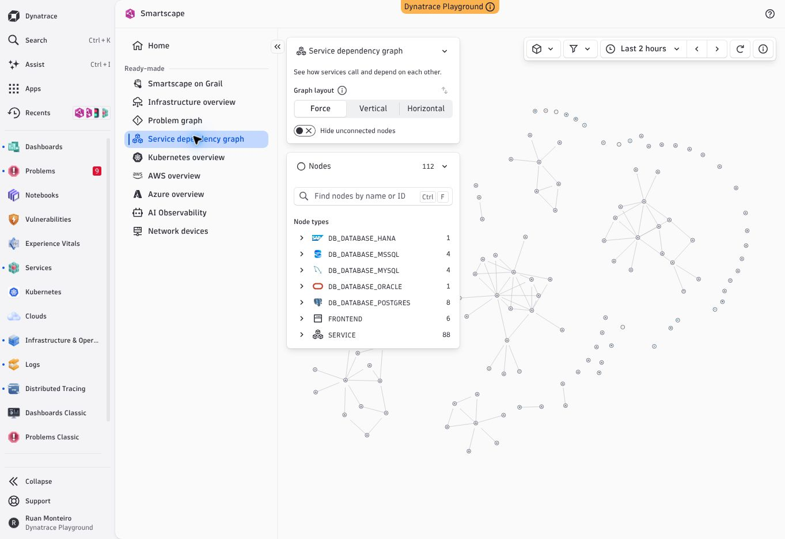

# Investigação funcional do Dynatrace e implementação APM

Data: 15/10/2026. Base: branch `feature/agents-gateway-i18n`, commit `7b671f7`. Trabalho: `feature/dynatrace-apm-investigation`.

## Limites da evidência

A investigação observou páginas autenticadas do Dynatrace Playground por controles de navegador. Não obteve código de servidor, OneAgent, Grail, algoritmos de Davis ou APIs privadas do produto. O código implementado é original, a partir de contratos abertos OpenTelemetry e comportamentos observáveis. A instalação do REA não equivale a uma análise concluída.

REA 6.5.0: registro Codex e skill alinhados no diagnóstico; nenhum endpoint CDP local do navegador remoto foi disponibilizado ao CLI. Uma análise do frontend local retornou `capability_unavailable` em `process-ownership/prepare_owned_process` com `ps: fatal library error, lookup self`. A evidência parcial `ev_7d341b4a10b019ed00e41f3d9060145b68ae5fe53505eee89d2cf47efa96bf59` NÃO demonstra execução ou análise completa. Este trabalho não afirma que o REA capturou o runtime do Dynatrace.

OmniRoute 3.8.51 instalado e CLI verificado. Diagnóstico não encontrou banco/configuração de provedores neste ambiente; nenhum modelo foi invocado e nenhuma telemetria foi enviada a provedores externos.

## Fluxos efetivamente observados

| Área | Evidência da UI | Implicação no Observa Lite |
|---|---|---|
| Services Explorer | Lista de serviços, Performance/Health, período, Now/Summary, filtros por segmentos e atributos; falhas, P50, throughput; colunas configuráveis | Substituir lista derivada de processos por entidades instrumentadas e métricas no período |
| Detalhe astroshop-checkout | Abas Overview, Properties, Logs, Metrics, Database queries, Messaging, Outbound calls, Infrastructure, Events, Alerts, Analyze | Cada aba exige dados e investigação próprios; menu não constitui suporte |
| Overview do serviço | Gráficos response time/throughput/failure rate; endpoint PlaceOrder; serviços incoming/outgoing | Métricas reais, agrupamento de endpoints e arestas com evidência de chamada |
| Distributed Tracing | Requisições filtradas pelo serviço; início, operação, duração, estado; painel de trace | Lista ligada ao serviço, drilldown e waterfall |
| Detalhe do span | Span details, Logs, Exceptions, Code stack trace; trace/span/parent IDs; atributos de processo, host, Kubernetes, deployment, recurso | Preservar eventos/atributos e explicitar dados ausentes; profiling não pode ser inferido de atributos |
| Problems | Active/Closed; categorias Availability/Error/Slowdown/Resource contention/Custom alert/Monitoring unavailable; impacto e severidade | Sistema de problemas requer regras e estados reais, não classificação cosmética |
| Detalhe P-26101550 | Impacto, 2 eventos, Deployment/Events/Logs/Troubleshooting; cartões Root cause, Visual resolution path e automações | RCA precisa de evidência; no exemplo a UI mostrava No root cause e ausência de visual resolution path |
| Logs | Filtros por fonte/severidade/Kubernetes/processo/host/cloud; período; consulta; gráfico por níveis; tabela timestamp/status/mensagem e colunas | Loki existente continua integração separada; sem equivalência DQL/OpenPipeline |
| Dashboard Kubernetes node - pods | Variáveis cluster/node, cards, CPU/memória por pod, tabelas, gráficos e links contextuais para Logs | Builder básico atual não é equivalente a dashboards Dynatrace/Grafana |
| Infrastructure & Operations | Inventário de hosts, Host Group, health/custom alerts, availability/reachability, CPU e disco | Inventário e snapshots atuais não substituem séries de recursos e detecção de anomalias |

A observação de um serviço, trace, problema e dashboard é amostra funcional. Não certifica todos os caminhos, permissões, planos, tecnologias ou funcionalidades do Dynatrace.

## Implementado nesta branch

- `POST /v1/traces`: OTLP HTTP JSON e protobuf, gzip, autenticação por token de agente, limites de payload/lote e validação antes de persistir.
- Spans com identidade trace/span, parent, serviço, namespace, instância, horários, atributos, recurso e eventos.
- Serviço lógico por namespace/nome, separado dos processos do sistema operacional.
- RED sobre spans SERVER/CONSUMER; client/internal não aumentam contagem de requisições. Falhas por status ERROR ou HTTP 5xx. Não há regras de falha configuráveis nesta etapa.
- P50/P95/P99 por nearest-rank; agrupamento por http.route quando recebido, senão nome do span. Nenhuma normalização inventada de URLs.
- Séries de 60 intervalos, limitadas aos 200 serviços com maior volume de requisições, zero em intervalos sem requisições observadas; zero não comprova disponibilidade.
- Service Mapping por `trace_id + parent_span_id` entre serviços. Sem inferência de chamadas HTTP a partir de sockets.
- Traces com waterfall, atributos, eventos/exceções e aviso de parents ausentes. Presença de raiz não comprova captura completa.
- API administrativa autenticada e UI com período, pesquisa, filtro de serviço/falha, erros, carregamento e estado vazio.
- Persistência com deduplicação de trace/span e rollback em falha de gravação.

## Limites de operação

Laboratório: retenção lógica de 24 horas, até 20.000 spans e 32 MiB de payload serializado de spans; span individual até 64 KiB, corpo HTTP comprimido e descomprimido até 4 MiB, lote até 10.000 spans. Dados mais antigos são descartados ao exceder capacidade; métricas refletem somente spans retidos. Persistência ainda usa JSON e regravação atômica do estado. Não há buffer durável no gateway nem ingestão escalável multiusuário. Sem ingestões novas, consultas ocultam spans expirados, embora limpeza física ocorra no próximo lote.

Tracing não instala instrumentação: aplicações ou Collector devem enviar spans. Descoberta de SO e Deep Monitoring continuam decisões separadas; o agente passivo não ganha instrumentação Java/.NET por receber este backend.

## Pendências para aproximar o produto

| Área | Estado após esta etapa | Próximo critério de aceite |
|---|---|---|
| OTLP HTTP traces | Básico implementado | Homologação com SDKs Java/.NET e carga representativa |
| OTLP gRPC / métricas / logs | Ausente | Receivers e armazenamento com quotas e contratos por sinal |
| Trace links, sampling flags e scope | Não persistidos | Fidelidade OTLP e correlação assíncrona |
| Autoinstrumentação Java/.NET, IIS, profiling, eBPF | Ausente | Compatibilidade, overhead, instalação e rollback medidos |
| Database queries / messaging / outbound analysis | Atributos disponíveis no span | Agregações específicas e drilldown testados |
| Anomalias, baseline, RCA causal e impacto | Ausente | Regras, séries, evidências e testes de causalidade |
| SLO / error budget / avaliação de deploy | Ausente | Janelas e indicadores confiáveis, estados e histórico |
| Logs correlacionados por trace/span | Parcial via atributos/eventos | Consulta Loki contextual e ingestão/retention independentes |
| Kubernetes / cloud / infraestrutura histórica | Inventário básico anterior | Coleta própria e relações verificadas |
| Dashboards / notebooks / DQL / workflows | Builder básico; demais ausentes | Persistência de consultas/painéis, execução e validação |
| RUM / mobile / synthetic browser / segurança | Ausente | Coleta específica, privacidade, backend e UI reais |
| RBAC / SSO / multi-tenant / audit trail | Ausente | Isolamento e autorização testados em cada API |
| Armazenamento distribuído / HA / filas duráveis | Ausente | Testes de falha, carga, recuperação e perda |

A auditoria anterior de 147 itens continua referência de escopo, mas as linhas de tracing e Service Mapping devem ser lidas com as atualizações desta branch. Não há alegação de paridade completa.

## Fontes primárias

- https://docs.dynatrace.com/docs/observe/application-observability/services/services-app
- https://docs.dynatrace.com/docs/observe/application-observability/services/services-concepts
- https://docs.dynatrace.com/docs/observe/application-observability/distributed-tracing/distributed-tracing-app
- https://opentelemetry.io/docs/specs/otlp/
- https://opentelemetry.io/docs/specs/otel/trace/api/

## Validação

Backend: `go test -race ./cmd/... ./internal/...`; `go vet ./cmd/... ./internal/...`. Frontend: `npm run typecheck`, testes Vitest de APM, `npm run build`. Verificação HTTP com processo real: envio OTLP, cinco consultas administrativas (serviços/traces/detalhe/mapa/séries), indicadores esperados e reinício do processo preservando dados. O navegador remoto bloqueou a URL local com ERR_BLOCKED_BY_CLIENT; isso limita validação visual integrada, não invalida os testes de componentes nem os de HTTP. Não homologado na VM do usuário e não publicado em produção.

## Ampliação da investigação e código — segunda passagem

A lista completa de cobertura atual está em [FEATURE-COVERAGE](../FEATURE-COVERAGE.md). Agora estão implementados logs/métricas OTLP, análise por categoria de chamadas, instâncias/versões, correlação trace-logs, SLO, problemas por regras explícitas e dashboards operacionais. As linhas de pendências acima registram a primeira passagem e foram parcialmente superadas; a matriz de cobertura é a referência de estado atual.

`Use latest features` foi ativado no Services. O tour do novo Explorer foi percorrido até5/5: Service Map/call paths, segmentos, filtros por campos Grail e drilldown de endpoints. Banco e outbound foram inspecionados; o serviço amostrado não tinha consultas de banco na janela, portanto as colunas foram observadas, mas valores reais desse fluxo não foram validados no tenant.

Smartscape Service dependency graph mostrou112 nós, tipos de banco (HANA/MSSQL/MYSQL/ORACLE/POSTGRES), frontends e serviços, layout Force/Vertical/Horizontal, filtros por nós/arestas, janela, limites e opção de ocultar desconectados. Isso é referência funcional, não prova de código interno. Screenshot original da UI:

SLO novo mostrou metas, warnings e14dias de avaliação; Add SLO estava desabilitado. A implementação própria não foi validada como equivalente a todos os modelos de SLO do Dynatrace.
